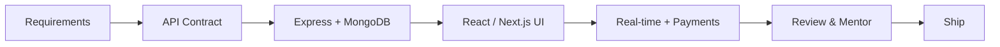

<!-- Replace YOUR_USERNAME with your GitHub username. Create a public repo with the same name as your username and add this as README.md -->

<div align="center">


<br/>

[](mailto:techroof360@gmail.com)
[](https://linkedin.com/in/the-aamirlatif)
[](https://wa.me/923137977197)
[](https://techroof.it.com/the-aamirlatif)
[](#)
[](#)

</div>

---

## ◼ Profile

I'm a **MERN Stack Developer** who builds responsive, scalable web applications across the whole stack, from polished React and Next.js interfaces to Express APIs and MongoDB data models. I've shipped **admin dashboards**, **real-time chat** with Socket.io and **end-to-end Stripe payments**, and I enjoy working closely with product and backend teams. I also mentor junior developers on API integration and code quality.

```ts
const aamir = {
  role: "Full Stack Developer (MERN)",
  currentlyAt: "Tekxai",
  experience: "4+ years professional · 5 incl. internship",
  education: "BS Software Engineering, GCU Faisalabad",
  strengths: ["REST API design", "Real-time features", "Payments", "System design"],
  languages: ["Urdu (Native)", "English (Fluent)"],
  lookingFor: "Challenging full-stack roles & remote collaborations",
};
```

---

## ◼ Tech Stack

| Layer | Technologies |
|:--|:--|
| **Frontend** |  |
| **Backend** |  |
| **Real-time & Payments** |   |
| **State Management** |   |
| **Tools** |  |
| **Architecture** | REST API Design · Microservices · System Design |

---

## ◼ Experience

<table>
<tr>
<td width="170" valign="top"><b>Jun 2025 – Present</b><br/><sub>Lahore</sub></td>
<td valign="top">

**Full Stack Developer (MERN) · Tekxai**
- Develop and maintain admin dashboards for service-based platforms using **React.js, Next.js** and REST APIs
- Built a **real-time chatbot** with Node.js and Socket.io
- Integrated **Stripe** for end-to-end payments
- Mentor junior developers on API integration and code quality

</td>
</tr>
<tr>
<td valign="top"><b>Jun 2024 – Jun 2025</b><br/><sub>Lahore · Australia-based client</sub></td>
<td valign="top">

**Full Stack Developer · WSF Soft**
- Built the frontend for **loadoutp2p.com** and integrated REST APIs
- Aligned API contracts with the backend team to keep frontend and server logic in sync

</td>
</tr>
<tr>
<td valign="top"><b>May 2023 – May 2024</b><br/><sub>Lahore</sub></td>
<td valign="top">

**Assistant Software Engineer & Trainer · SIP Operations & NAVTTC**
- Supported custom software development on the **visiochart.com/beta** project
- Trained incoming developers on workflows and debugging techniques

</td>
</tr>
<tr>
<td valign="top"><b>Apr 2022 – Apr 2023</b><br/><sub>Faisalabad</sub></td>
<td valign="top">

**Software Developer · MicrologicX Software House**
- Built frontends for the **Dawn Analytical calibrator** and the MicrologicX portfolio website, integrating REST APIs

</td>
</tr>
<tr>
<td valign="top"><b>Oct 2021 – Apr 2022</b><br/><sub>Faisalabad</sub></td>
<td valign="top">

**Web Intern Developer · MicrologicX Software House**
- Full-cycle exposure while building a dynamic frontend for a tech-accessories platform

</td>
</tr>
</table>

---

## ◼ Projects

| Project | Period | Status |
|:--|:--|:--|
| [**stadiumpulselive.com**](https://app.stadiumpulselive.com) | Jun 2026 – Present | 🟢 Active |
| [**youthsportify.com**](https://youthsportify.com) | Mar 2026 – Present | 🟢 Active |
| [**flowlgx.com**](https://flowlgx.com) | Oct 2025 – Present | 🟢 Active |
| [**sanctuary-travel.com**](https://app.sanctuary-travel.com) | Aug 2025 – Mar 2026 | ✅ Delivered |
| [**harvestintegrated.com**](https://app.harvestintegrated.com) | Jun 2025 – Dec 2025 | ✅ Delivered |
| [**visiochart.com/beta**](https://visiochart.com/beta) | Apr 2022 – Sep 2024 | ✅ Delivered |
| [**micrologicx.net**](https://micrologicx.net) | Apr 2021 – Oct 2022 | ✅ Delivered |

> ✏️ **Tip:** add a one-line description and tech tags per project (e.g. *"Admin dashboard · Next.js · Stripe"*) to make this section stronger.

---

## ◼ How I Work



<table>
<tr>
<td width="33%" valign="top">

**Full-stack range**<br/>
UI, server logic and system design handled by one developer.

</td>
<td width="33%" valign="top">

**Real-time & payments**<br/>
Socket.io chat experiences and Stripe checkout flows, end to end.

</td>
<td width="33%" valign="top">

**Team player**<br/>
Clear API contracts, code-quality focus and mentoring of juniors.

</td>
</tr>
</table>

---

## ◼ Education & Certifications

- 🎓 **BS Software Engineering**, Govt. College University Faisalabad (2015 – 2019) · CGPA 3.42
- 📜 **Web Development Certificate** (2021 – 2022)
- 🏆 **Project Management Certification** · merit-based competition

---

## ◼ GitHub Activity

<div align="center">


</div>

---

<div align="center">

**Let's build something great together.**

[](mailto:techroof360@gmail.com)
[](https://wa.me/923137977197)
[](https://linkedin.com/in/the-aamirlatif)
[](https://techroof.it.com/the-aamirlatif)

<sub>📍 Lahore, Pakistan · Available for full-time roles & freelance projects</sub>


</div>
